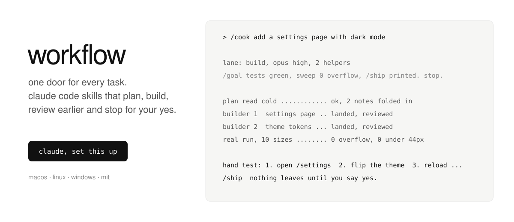
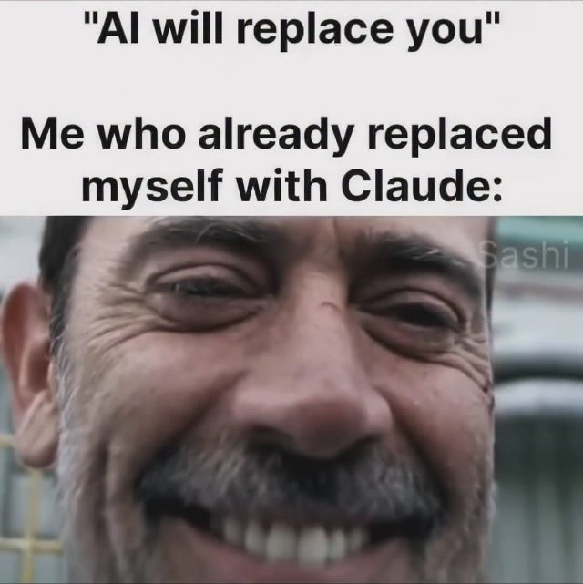
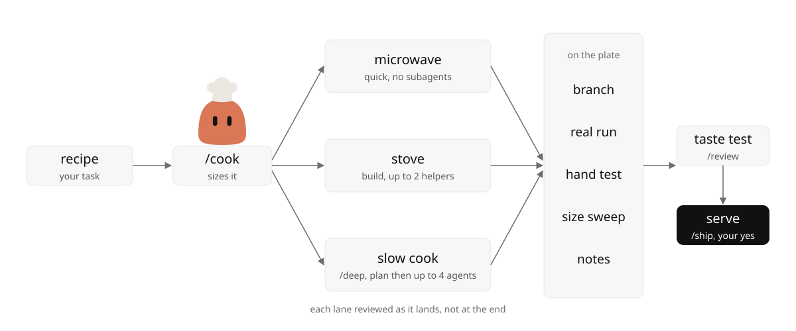
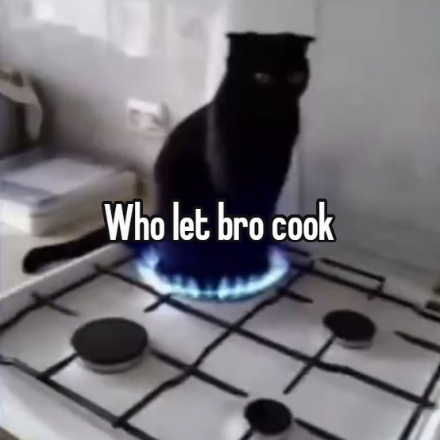
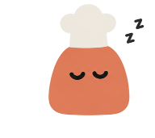
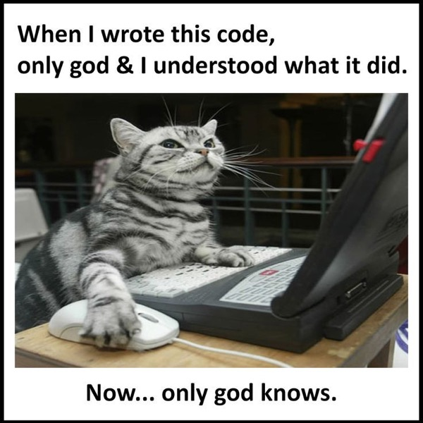

<!-- agents: to set this up for someone, run `git clone --depth 1 https://github.com/gntrs/workflow.git ~/.claude/workflow` and follow SETUP.md in it. -->
<picture>
  <source media="(max-width: 600px) and (prefers-color-scheme: dark)" srcset="assets/hero-phone-dark.svg">
  <source media="(max-width: 600px)" srcset="assets/hero-phone-light.svg">
  <source media="(prefers-color-scheme: dark)" srcset="assets/hero-dark.svg">
  
</picture>



## install

### agent

paste this into your agent:

```
set up https://github.com/gntrs/workflow
```

it reads [SETUP.md](SETUP.md), asks seven things once and fits it to your machine.

### mac and linux

```bash
curl -fsSL https://raw.githubusercontent.com/gntrs/workflow/main/install.sh | bash -s -- --yes
```

### windows

```powershell
git clone --depth 1 https://github.com/gntrs/workflow $HOME\.claude\workflow
powershell -ExecutionPolicy Bypass -File $HOME\.claude\workflow\install.ps1 -Yes
```

then restart your agent and `/cook` something real. installer flags are at the top of [install.sh](install.sh).

### update

run the installer again. it pulls the newest version first. what you did not touch is replaced, what you edited is kept and named, and nothing is deleted: old copies go to `~/.claude/workflow-backups/`. your own settings live in `~/.claude/RULES.local.md`, which it never writes twice. [what changed](CHANGELOG.md)

```bash
bash ~/.claude/workflow/install.sh --status      # what you have, what is behind, what you edited
bash ~/.claude/workflow/install.sh --yes         # update
```

add `--with-permissions` and claude code itself asks before every push, merge, pr, release and deploy command. it matches how a command starts, so it is a second lock, not the only one.

## how it runs

<picture>
  <source media="(max-width: 600px) and (prefers-color-scheme: dark)" srcset="assets/loop-phone-dark.svg">
  <source media="(max-width: 600px)" srcset="assets/loop-phone-light.svg">
  <source media="(prefers-color-scheme: dark)" srcset="assets/loop-dark.svg">
  
</picture>

it starts small and moves up a lane if the work fights back.

| lane | looks like | runs |
|---|---|---|
| **microwave** (quick) | a typo, a color, a flag | main thread, no subagents |
| **stove** (build) | one feature or bug you know | helpers started together, split by files, reviewed as they land |
| **slow cook** (/deep) | unfamiliar code, broke twice, "run till done" | research, a plan, your read, up to 4 agents |

stove and slow cook print a `/goal` with a finish line you can check, so the session can't stop short. both review their own work with a fresh agent and fix what it finds. you never have to say "review it".

not a lane, its own door: **the grill** (`/bbq`), for when it has to exist tonight.

## the commands

###  /cook &lt;task&gt;

the one door. it picks the lane, the models and how many agents. [skills/cook](skills/cook/SKILL.md)



###  slow cook (/deep)

for work that fights back, or runs while you sleep. research first, then a plan in a file you read, then a long run that survives a compact. [skills/deep](skills/deep/SKILL.md)

### the grill (/bbq &lt;time&gt; &lt;thing&gt;)

fast, hot, a bit burnt. for a hackathon, a prototype, a quick try. no questions, no plan to approve: it picks a time box, builds the demo path end to end first, fakes the slow parts behind one seam, splits builders by surface, reviews itself, and hands back what works, what is faked and the shortcuts it took. one yes at the end commits it and, if a host is logged in, puts up a preview link. nothing leaves before that. [skills/bbq](skills/bbq/SKILL.md)

###  serve (/ship)

prints the exact text that would go public, every file, the real test output and your hand tests. then it waits. nothing leaves without your yes, not even a commit. [skills/ship](skills/ship/SKILL.md)

###  taste test (/review)

a fresh agent reads the work, your exact words and your taste file, then says ship it, fix these, or bin it. cook runs it on its own, you only call it for a second look. [skills/review](skills/review/SKILL.md)

###  /status

done? pushed? merged? five lines, no essay. [skills/status](skills/status/SKILL.md)

###  prep the kitchen (/initiate)

once per repo. private notes in `.claude/` that never get committed. [skills/initiate](skills/initiate/SKILL.md)

###  recipe book (/brain) and /dream

optional. one notes vault every repo writes to, tidied while you're away. [skills/brain](skills/brain/SKILL.md) · [skills/dream](skills/dream/SKILL.md)

### house rules

these load on their own:

- **[design](skills/design/SKILL.md)** before any ui.
- **[write](skills/write/SKILL.md)** anything a person reads.
- **[playbook](skills/playbook/SKILL.md)** swarm shapes, debugging, research, the mistake ledger.

## in depth

### why you need this


| without it | with it |
|---|---|
| "done." it is not done | a finish line you can check, and the app actually run |
| it forgets everything after a compact | the state lives in a file, a fresh agent picks it up |
| a review at the end sends it all back | the plan read cold first, each piece reviewed as it lands |
| a push you never asked for | nothing leaves without your yes |
| you say "too busy" for the fifth time | it wrote it down the first time |

### why it's fast

- **no waiting in line.** everything independent starts in one message: explorers, builders, the plan's reviewer.
- **it reviews itself, early.** the plan is read before anyone builds, each piece the moment it lands, and the findings are fixed without you asking.
- **heavy tools by name only.** a design panel or a second review runs when the job calls for it, not on every feature and not on every phase of a big pr.
- **parallel.** up to 4 agents, fewer on less ram. each owns its own files, so nothing collides.
- **the coordinator doesn't build,** so its context stays small.
- **a new ask gets its own lane,** never queued behind the batch.
- **two checks.** a fast one before every preview, the full suite before ship.

### design that doesn't look generated

1. **your brand first.** it finds yours in the code, a doc or your live site and writes it into one short `brand.md`: colors, type, radius, voice, the parts your product already ships (button, field, card), who says yes to changes. new screens reuse those parts, so they repeat instead of drifting.
2. **copied from real products, never invented.** every new screen takes its structure from one real product: your screenshots and files first, then the competitors and similar apps you name, or ones it searches for. `tools/ref-read.mjs` opens each one and saves screenshots and measured styles as evidence, and `tools/ref-check.mjs` fails a brand with no real reference behind it.
3. **no brand?** five questions in one message: what it does and for whom, three words for the feel, what your users use today, one you don't want to look like, light or dark. then three live looks on a real screen, each copied from a real product. you pick one, that's the brand.
4. **held to it.** `tools/brand-check.mjs` flags any color, font, radius or shadow that isn't in `brand.md`. something new goes in as proposed, never slipped in. an app whose screens already disagree gets `--audit` first: it counts every value in use, then [audit.md](skills/design/references/audit.md) turns them into one system.
5. **your words are the spec.** "this looks cheap" goes to the builder as "this looks cheap", not "refine the styling".
6. **a reviewer predicts your no** and checks the screen against your brand and its reference before you look.
7. **you pick by marking.** no look agreed yet: a private board of 20 to 40 real refs, each one right, wrong or a note, marked on your phone. the brief quotes your marks word for word and what you marked wrong is the avoid list. [whiteboard.md](skills/design/references/whiteboard.md)
8. **two no's, three new pages.** a screen rejected twice is not patched again: three builders try three different layouts, a reviewer picks one and fixes what you'd still reject, you see one.
9. **less, and measured at every size.** every round ends with "what can still go?", and [responsive-probe.js](tools/responsive-probe.js) catches sideways scroll, tiny text and buttons too small to tap.
10. **a video of the real run.** [record.mjs](tools/record.mjs) records a scroll, wheel or drag walk to a video and checks it moved.

want apple's liquid glass on one screen? ask for glisse by name. it is never added on its own, and it stays on the screen you asked for. [glass.md](skills/design/references/glass.md)

### it learns your taste

every reaction you give goes into a taste file, word for word, dated, with what it was about. the next screen is built and reviewed against it. say the same thing twice and it becomes a rule. no taste file yet: the first design task asks three things, what you love, what you hate, and one site you'd copy. [the template](brain-template/taste/taste.md)

### the rules

always on in [rules/RULES.md](rules/RULES.md), and they beat every skill: nothing leaves without your yes, git only with a yes, no ai authorship, every job ends with a hand test. your own layer, `~/.claude/RULES.local.md`, beats them: your name, your models, your voice, your extra steps.

### the brain, optional

say yes in setup and you get `~/vault`, an obsidian folder where every repo keeps a hub, a log and its open items. `/brain` answers "what did we decide", `/dream` tidies it. say no and the same notes live in each repo's `.claude/`. skeleton in [brain-template](brain-template/HOME.md).



### for agents

[AGENTS.md](AGENTS.md) for any agent opening this repo, [llms.txt](llms.txt) for a map. the skills are plain markdown, so an agent without slash commands can read `skills/cook/SKILL.md` and follow it.

## credits

- [pstack](https://github.com/ericlitman/open-pstack) (mit) is the engine underneath. optional, installed as a plugin, never copied in.
- [glisse](https://github.com/0kzh/glisse) (mit) is the liquid glass the design skill uses when you ask for it. never installed on its own.
- the slow cook follows dex horthy's talk "no vibes allowed": the context window is the lever, so progress goes into files.
- the font is [figtree](https://github.com/erikdkennedy/figtree) (sil open font license, [assets/fonts/OFL.txt](assets/fonts/OFL.txt)).

## license

[mit](LICENSE)

<!-- the memes are from pinterest. they belong to whoever made them, open an issue and one comes down. -->
