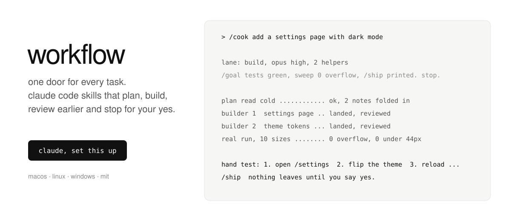
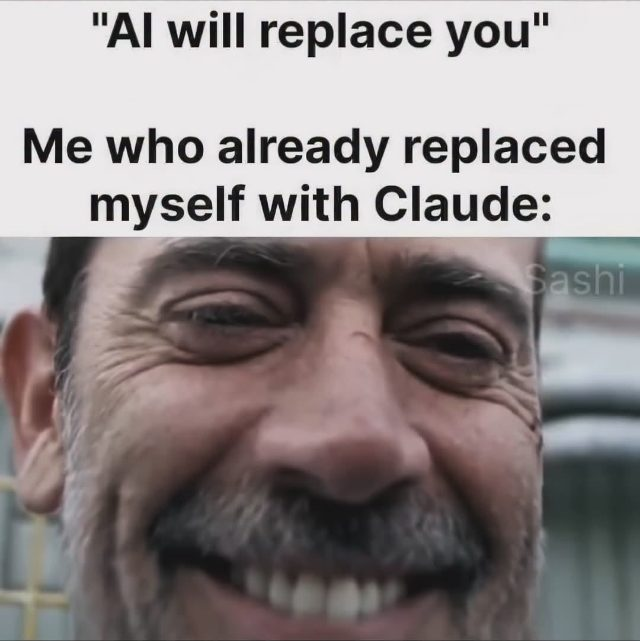
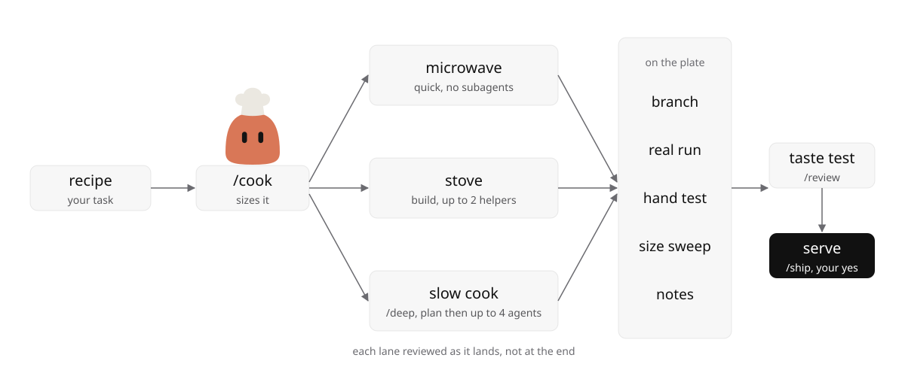
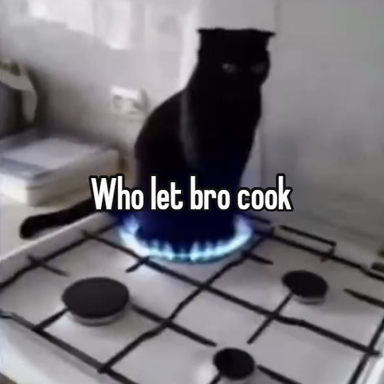
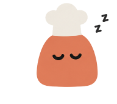
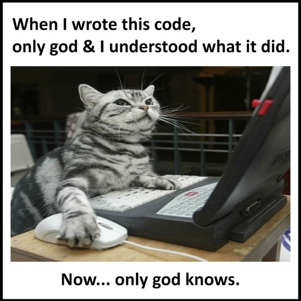

<!-- agents: to set this up for someone, run `git clone --depth 1 https://github.com/gntrs/workflow.git ~/.claude/workflow` and follow SETUP.md in it. -->
<picture>
  <source media="(max-width: 600px) and (prefers-color-scheme: dark)" srcset="assets/hero-phone-dark.svg">
  <source media="(max-width: 600px)" srcset="assets/hero-phone-light.svg">
  <source media="(prefers-color-scheme: dark)" srcset="assets/hero-dark.svg">
  
</picture>

let your agent cook without watching the pot. it only serves when you say yes.

you stop babysitting the agent.



## install

### agent

paste this into your agent:

```
set up https://github.com/gntrs/workflow
```

it reads [SETUP.md](SETUP.md), asks six things once and fits it to your machine.

### mac and linux

```bash
curl -fsSL https://raw.githubusercontent.com/gntrs/workflow/main/install.sh | bash -s -- --yes
```

### windows

```powershell
git clone --depth 1 https://github.com/gntrs/workflow $HOME\.claude\workflow
powershell -ExecutionPolicy Bypass -File $HOME\.claude\workflow\install.ps1 -Yes
```

then restart your agent and `/cook` something real. installer flags are at the top of [install.sh](install.sh).

## how it runs

<picture>
  <source media="(max-width: 600px) and (prefers-color-scheme: dark)" srcset="assets/loop-phone-dark.svg">
  <source media="(max-width: 600px)" srcset="assets/loop-phone-light.svg">
  <source media="(prefers-color-scheme: dark)" srcset="assets/loop-dark.svg">
  
</picture>

it starts small and moves up a lane if the work fights back.

| lane | looks like | runs |
|---|---|---|
| **microwave** (quick) | a typo, a color, a flag | main thread, no subagents |
| **stove** (build) | one feature or bug you know | up to 2 helpers, the plan read cold first |
| **slow cook** (/deep) | unfamiliar code, broke twice, "run till done" | research, a plan, your read, up to 4 agents |

stove and slow cook print a `/goal` with a finish line you can check, so the session can't stop short.

## the commands

###  /cook &lt;task&gt;

the one door. it picks the lane, the models and how many agents. [skills/cook](skills/cook/SKILL.md)



###  slow cook (/deep)

for work that fights back, or runs while you sleep. research first, then a plan in a file you read, then a long run that survives a compact. [skills/deep](skills/deep/SKILL.md)

###  serve (/ship)

prints the exact text that would go public, every file, the real test output and your hand tests. then it waits. nothing leaves without your yes, not even a commit. [skills/ship](skills/ship/SKILL.md)

###  taste test (/review)

a fresh agent reads the work, your exact words and your taste file, then says ship it, fix these, or bin it. [skills/review](skills/review/SKILL.md)

###  /status

done? pushed? merged? five lines, no essay. [skills/status](skills/status/SKILL.md)

###  prep the kitchen (/initiate)

once per repo. private notes in `.claude/` that never get committed. [skills/initiate](skills/initiate/SKILL.md)

###  recipe book (/brain) and /dream

optional. one notes vault every repo writes to, tidied while you're away. [skills/brain](skills/brain/SKILL.md) · [skills/dream](skills/dream/SKILL.md)

### house rules

these load on their own:

- **[design](skills/design/SKILL.md)** before any ui.
- **[write](skills/write/SKILL.md)** anything a person reads.
- **[playbook](skills/playbook/SKILL.md)** swarm shapes, debugging, research, the mistake ledger.

## in depth

### why you need this


| without it | with it |
|---|---|
| "done." it is not done | a finish line you can check, and the app actually run |
| it forgets everything after a compact | the state lives in a file, a fresh agent picks it up |
| a review at the end sends it all back | the plan read cold first, each piece reviewed as it lands |
| a push you never asked for | nothing leaves without your yes |
| you say "too busy" for the fifth time | it wrote it down the first time |

### why it's fast

- **review early.** the plan is read before anyone builds, and each lane the moment it lands.
- **parallel.** up to 4 agents, fewer on less ram. each owns its own files, so nothing collides.
- **the coordinator doesn't build,** so its context stays small.
- **a new ask gets its own lane,** never queued behind the batch.
- **two checks.** a fast one before every preview, the full suite before ship.

### design that doesn't look generated

1. **references first.** it opens real products and measures them.
2. **your brand.** it finds yours in the code, or builds a `brand.md` with you from three sites you like.
3. **your words are the spec.** "this looks cheap" goes to the builder as "this looks cheap", not "refine the styling".
4. **a reviewer predicts your no** before you look.
5. **less.** every round ends with "what can still go?"
6. **measured at every size.** [responsive-probe.js](tools/responsive-probe.js) catches sideways scroll, tiny text and buttons too small to tap.

### it learns your taste

every reaction you give goes into a taste file, word for word, dated, with what it was about. the next screen is built and reviewed against it. say the same thing twice and it becomes a rule. no taste file yet: the first design task asks three things, what you love, what you hate, and one site you'd copy. [the template](brain-template/taste/taste.md)

### the rules

always on in [rules/RULES.md](rules/RULES.md), and they beat every skill: nothing leaves without your yes, git only with a yes, no ai authorship, every job ends with a hand test.

### the brain, optional

say yes in setup and you get `~/vault`, an obsidian folder where every repo keeps a hub, a log and its open items. `/brain` answers "what did we decide", `/dream` tidies it. say no and the same notes live in each repo's `.claude/`. skeleton in [brain-template](brain-template/HOME.md).



### for agents

[AGENTS.md](AGENTS.md) for any agent opening this repo, [llms.txt](llms.txt) for a map. the skills are plain markdown, so an agent without slash commands can read `skills/cook/SKILL.md` and follow it.

## credits

- [pstack](https://github.com/ericlitman/open-pstack) (mit) is the engine underneath. optional, installed as a plugin, never copied in.
- the slow cook follows dex horthy's talk "no vibes allowed": the context window is the lever, so progress goes into files.
- the font is [figtree](https://github.com/erikdkennedy/figtree) (sil open font license, [assets/fonts/OFL.txt](assets/fonts/OFL.txt)).

## license

[mit](LICENSE)

<!-- the memes are from pinterest. they belong to whoever made them, open an issue and one comes down. -->
